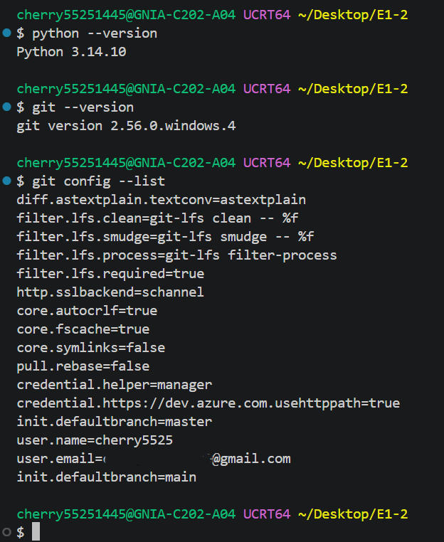
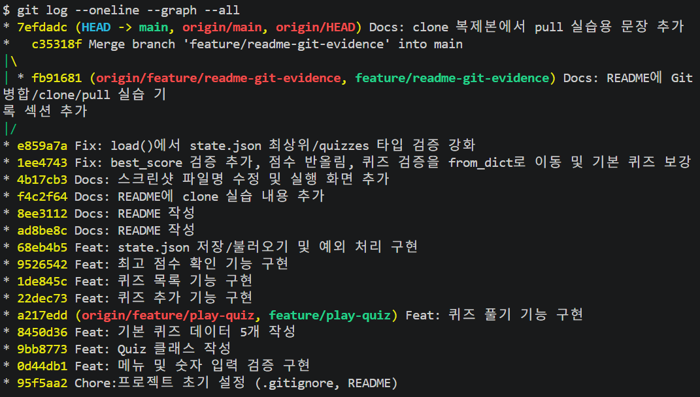
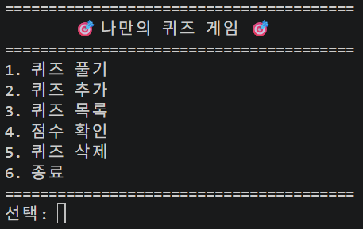
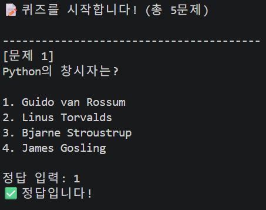
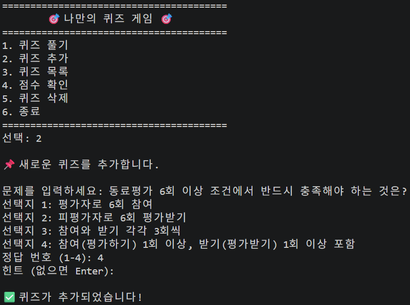
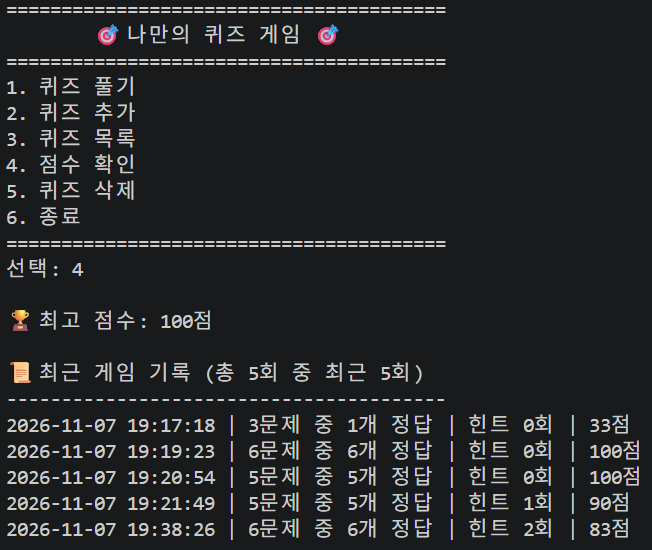

# 🎯 나만의 퀴즈 게임

## 프로젝트 개요
터미널에서 실행하는 Python 콘솔 퀴즈 게임입니다.
메뉴에서 번호를 선택해 퀴즈 풀기, 퀴즈 추가, 퀴즈 목록 보기, 최고 점수 확인을 할 수 있습니다.
퀴즈와 최고 점수는 `state.json` 파일에 저장되어, 프로그램을 종료하고 다시 실행해도 유지됩니다.

- 사용 언어: Python 3.10 이상 (외부 라이브러리 없음)
- 사용 기술: 클래스(`Quiz`, `QuizGame`), JSON 파일 입출력, 예외 처리(try/except)
- 버전 관리: Git / GitHub (기능 단위 커밋, 브랜치 작업 후 병합)

## 퀴즈 주제와 선정 이유
**주제: Python 기초 문법**

이번 미션을 하면서 배운 문법을 퀴즈로 다시 확인하면 복습이 되기 때문에 선택했습니다. 직접 문제를 만들면서 변수, 자료형, 조건문 개념을 한 번 더 정리할 수 있었습니다.

## 실행 방법
1. Python 3.10 이상이 설치되어 있어야 합니다.
2. 저장소를 내려받습니다.
   ```bash
   git clone https://github.com/cherry5525/quiz-game.git
   cd quiz-game
   ```
3. 프로그램을 실행합니다.
   ```bash
   python main.py
   ```
   (Mac/Linux에서 `python`이 동작하지 않으면 `python3 main.py`)

## 기능 목록
| 메뉴 | 설명 |
|---|---|
| 1. 퀴즈 풀기 | 저장된 퀴즈를 순서대로 출제하고 정답/오답을 알려 준 뒤 결과 점수를 보여 줍니다. 최고 점수를 넘으면 갱신합니다. |
| 2. 퀴즈 추가 | 문제, 선택지 4개, 정답 번호를 입력해 새 퀴즈를 등록하고 파일에 저장합니다. |
| 3. 퀴즈 목록 | 등록된 퀴즈의 문제 목록을 보여 줍니다. |
| 4. 점수 확인 | 저장된 최고 점수를 보여 줍니다. |
| 5. 종료 | 프로그램을 종료합니다. |

**입력/예외 처리**
- 입력 앞뒤 공백 제거
- 빈 입력, 숫자가 아닌 입력, 허용 범위 밖 숫자 입력 시 안내 후 재입력
- `Ctrl+C`(KeyboardInterrupt) 또는 입력 종료(EOFError) 시 저장 후 안전하게 종료
- `state.json`이 없으면 기본 퀴즈로 시작, 손상되었으면 안내 후 기본 퀴즈로 초기화

## 파일 구조
```
quiz-game/
├── main.py        # Quiz, QuizGame 클래스와 프로그램 진입점
├── state.json     # 퀴즈 목록과 최고 점수 저장 파일 (기본 예시 데이터 포함)
├── README.md      # 프로젝트 설명
├── .gitignore     # Git 추적 제외 목록
└── docs/
    └── screenshots/
        ├── add_quiz.png   # 퀴즈 추가 화면
        ├── dev_env.png    # 개발 환경
        ├── git_log.png    # git log 결과
        ├── menu.png       # 메뉴 화면
        ├── play.png       # 퀴즈 풀기 화면
        └── score.png      # 점수 확인 화면
```

**main.py 구성**
- `read_int()`, `read_text()`: 입력 검증 도우미 함수
- `Quiz`: 문제, 선택지, 정답을 가진 퀴즈 하나를 표현 (출력, 정답 확인, dict 변환)
- `QuizGame`: 메뉴, 퀴즈 풀기/추가/목록/점수 확인, 파일 저장/불러오기 등 게임 전체를 관리

## 데이터 파일 설명 (state.json)
- **경로**: 프로젝트 루트 (`main.py`와 같은 폴더)
- **역할**: 퀴즈 목록과 최고 점수를 저장해 프로그램을 다시 실행해도 유지되게 합니다.
- **인코딩**: UTF-8
- **생성 시점**: 퀴즈를 풀거나 추가한 뒤, 그리고 프로그램 종료 시 자동 저장됩니다.

| 필드 | 타입 | 설명 |
|---|---|---|
| `quizzes` | list | 퀴즈 객체들의 목록 |
| `quizzes[].question` | str | 문제 |
| `quizzes[].choices` | list(str) | 선택지 4개 |
| `quizzes[].answer` | int | 정답 번호 (1~4) |
| `best_score` | int 또는 null | 최고 점수 (아직 퀴즈를 풀지 않았으면 `null`) |

```json
{
    "quizzes": [
        {
            "question": "Python의 창시자는?",
            "choices": ["Guido van Rossum", "Linus Torvalds", "Bjarne Stroustrup", "James Gosling"],
            "answer": 1
        }
    ],
    "best_score": 80
}
```

## 개발 환경
Python 버전, Git 버전, VS Code 환경입니다.



## Git 작업 기록
`git log --oneline --graph` 결과입니다. 기능 단위로 커밋했고, `feature/play-quiz` 브랜치를 만들어 작업한 뒤 main에 병합했습니다.




## 실행 화면







## clone 실습으로 추가한 줄입니다
quiz-game-clone/README.md